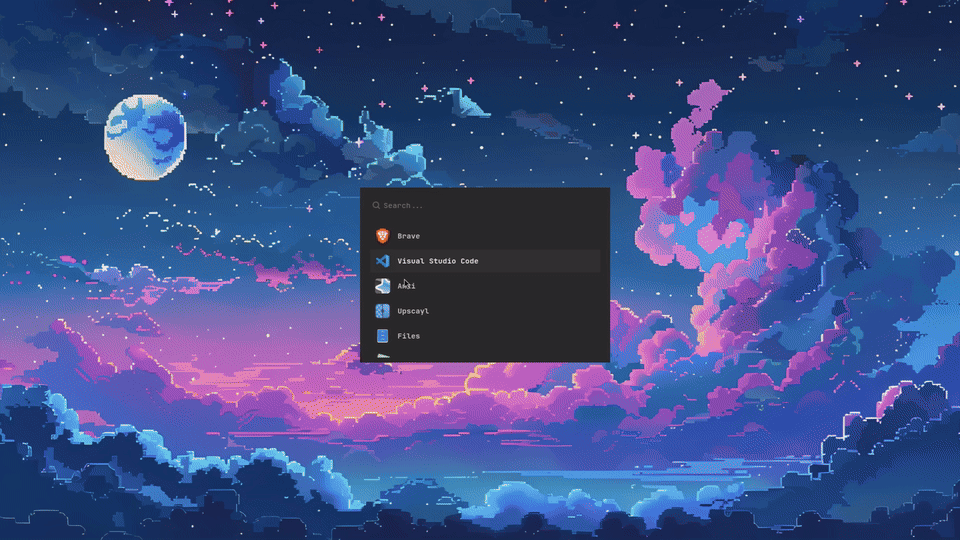

# sway-instant-response

**Instant open and close for Sway / SwayFX.** A dark placeholder with the app's icon appears the moment you launch or close a window, hiding the slow startup and shutdown of heavy apps.

## Why?

Sway often doesn't respond instantly when you open a heavy app. Sometimes the window takes a few seconds to appear, which makes the whole system feel slow even though nothing is wrong. This project shows a placeholder window the instant you press the key, so you get immediate feedback while the real app loads in the background.



## Features

- **Opening:** when you launch an app with `instant-launch` (Super+D in the example), a placeholder with the app name and icon shows immediately while the real app starts in the background. It disappears when the real window appears.
- **Closing:** when you close a window with `instant-close` (Super+Q in the example), a placeholder covers the window's exact position and size while the app shuts down.
- **Pre-started placeholder:** a hidden placeholder is kept running, so the closing placeholder shows with no startup delay.
- **Safe:** the original window is only closed after the placeholder is in place. If anything fails, the app stays open.
- Terminals are closed directly, with no placeholder.

## Requirements

- Sway or SwayFX (SwayFX gives the pop-in animation)
- `python`, `python-gobject`, `gtk4`
- `wofi`, `gtk-launch`

Arch: `sudo pacman -S python python-gobject gtk4 wofi`

## Install

```bash
git clone https://github.com/theanomalousphase/sway-instant-response
cd sway-instant-response && ./install.sh
```

The installer copies the files and prints the lines to add to `~/.config/sway/config`. It never edits your config. Then run `swaymsg reload`.

## Custom keybindings

Super+D and Super+Q are only examples. Bind the scripts to any keys you like in `~/.config/sway/config`:

```
bindsym $mod+Shift+q exec ~/.local/bin/instant-close
bindsym $mod+Return exec ~/.local/bin/instant-launch
```

The closing placeholder appears only when a window is closed through `instant-close`. Closing with the window's own X button or Sway's plain `kill` skips it.

## Uninstall

```bash
./uninstall.sh
```

## How it works

It uses `swaymsg` to read the window tree and place a small GTK4 placeholder window at the target's exact geometry. On close, a hidden placeholder is moved into place and revealed with one Sway command, then a new hidden one is started.

## Known limits

- Sway/SwayFX only. It does not work on other compositors.
- Tuned on a single 1920x1080 monitor with 4px transparent borders. Other setups may need small adjustments.
- Apps that show a "save changes?" dialog keep their window, and the placeholder is removed after 2 seconds.

## License

MIT
